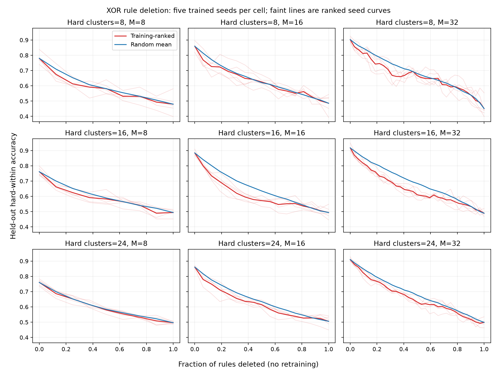

# XOR coalition generalization — outcome

Protocol: [xor_coalition_protocol.md](xor_coalition_protocol.md). Raw results: [xor_coalition_summary.json](xor_coalition_summary.json).

45 banks; seeds 0–4, dim=32, 24 total clusters, 1500 steps, 512 held-out rows per bank. Hard-row counts vary with the number of hard clusters. No fits were excluded.

| Hard clusters | M | Accuracy mean (range) | Coalition banks | Packing rules | Material rules | Rules flipping rows | Ranked − random AUC |
|---:|---:|---|---:|---:|---:|---:|---:|
| 8 | 8 | 0.780 (0.740–0.838) | 5/5 | 40/40 | 28/40 | 40/40 | -0.016 |
| 8 | 16 | 0.859 (0.819–0.896) | 5/5 | 80/80 | 32/80 | 80/80 | -0.009 |
| 8 | 32 | 0.902 (0.887–0.925) | 5/5 | 160/160 | 16/160 | 159/160 | -0.021 |
| 16 | 8 | 0.761 (0.737–0.799) | 5/5 | 40/40 | 27/40 | 40/40 | -0.016 |
| 16 | 16 | 0.884 (0.867–0.909) | 5/5 | 80/80 | 32/80 | 80/80 | -0.043 |
| 16 | 32 | 0.917 (0.897–0.949) | 5/5 | 160/160 | 8/160 | 160/160 | -0.042 |
| 24 | 8 | 0.760 (0.734–0.783) | 5/5 | 40/40 | 29/40 | 40/40 | -0.006 |
| 24 | 16 | 0.861 (0.852–0.871) | 5/5 | 80/80 | 24/80 | 80/80 | -0.023 |
| 24 | 32 | 0.910 (0.900–0.928) | 1/5 | 160/160 | 2/160 | 160/160 | -0.025 |

**Predeclared robustness criterion:** FAIL (coalition in at least 4/5 seeds in every cell).

Intact accuracy >0.65: 45/45 banks. Noisy hard-cluster margin concentration is spread for 735/840 rules. This diagnostic excludes easy clusters and does not repeat the original clean/weight agreement test.

AUC integrates accuracy over deleted fraction. A negative ranked-minus-random value means training-ranked deletion damages held-out performance more. Random permutations are averaged within each bank before averaging banks; they are not independent training seeds.



The raw JSON retains every single-rule effect, training ranking, deletion permutation, full curve, and first material cumulative deletion count. Endpoint checks ensure all orders begin intact and end at the same raw-atom-only model.

Limitations: five seeds, fixed total vocabulary and dimension, synthetic generator, no retraining. Two seed-0 cells reproduce prior findings. Packing means a measurable margin effect on disjoint clusters; it does not itself imply a large accuracy effect. The inherited coalition label means at least one material single-rule deletion; it does not establish a unique minimal coalition.


## Cumulative deletion details

Ranges below are across trained seeds. First crossing is the number of ranked deletions needed for a >0.05 drop; these curves can recover after crossing.

| Hard clusters | M | Ranked first crossing (range) | Ranked − random AUC range |
|---:|---:|---|---|
| 8 | 8 | 1–1 | -0.026–-0.005 |
| 8 | 16 | 1–1 | -0.026–+0.011 |
| 8 | 32 | 1–3 | -0.044–+0.013 |
| 16 | 8 | 1–1 | -0.033–-0.003 |
| 16 | 16 | 1–1 | -0.066–-0.030 |
| 16 | 32 | 1–3 | -0.058–-0.020 |
| 24 | 8 | 1–1 | -0.019–+0.005 |
| 24 | 16 | 1–1 | -0.033–-0.013 |
| 24 | 32 | 1–4 | -0.047–-0.011 |

## Interpretation

Unrelated packing survives this grid: every rule moves mean margins on multiple disjoint hard clusters. The stronger claim that every bank contains a material single rule does not: the M=32, 24-hard-cluster cell has coalition in only 1/5 seeds, versus 5/5 in every other cell.

At that boundary, the four banks without a material single-rule deletion cross the same accuracy-drop threshold after 2–4 training-ranked deletions. Extra capacity permits small individual effects alongside cumulative dependence. This is compatible with redundancy; the experiment does not identify an interaction mechanism or a minimal causal coalition.

The original all-spread result also needs qualification: 105/840 rules have more than half their noisy hard-cluster margin-change mass on one cluster. All still move other clusters. This restricted hard-cluster diagnostic differs from the original all-cluster, clean-input, and weight agreement audit, so it does not directly overturn that audit.

Training-ranked deletion has lower mean accuracy AUC than random deletion in every cell, but not every seed. It is a useful average diagnostic, not a uniformly better deletion order. A natural next experiment is retraining after pruning, with rule budgets matched, to test whether the observed redundancy can be used to compress the bank without losing accuracy.


## Reproduce

Base: main commit `d8493c2`; the JSON records the sweep configuration, PyTorch version, and SHA-256 hashes of the frozen sweep, training loop, generator, participation helpers, and prospective protocol. The seed-0 M=8/16, n_hard=24 accuracies reproduce the prior audit exactly.

```bash
.venv/bin/python experiments/xor_coalition_sweep.py --output /tmp/xor-coalition.json
MPLCONFIGDIR=/tmp/pil-mpl .venv/bin/python experiments/xor_coalition_report.py /tmp/xor-coalition.json --output /tmp/xor-coalition.md
```
